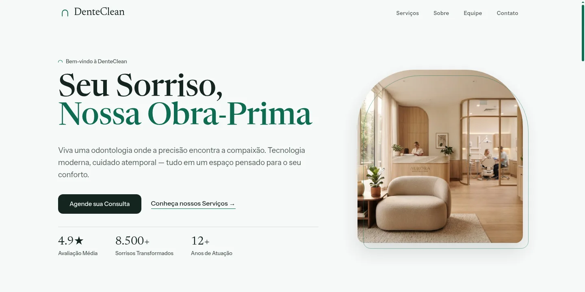

# DenteClean Website Template

[Português (pt-BR)](README.pt-BR.md)

A configurable, static clinic website built with HTML, CSS, and vanilla JavaScript. Clinic-facing copy, contact details, images, and accessibility text live in `site.config.json`; the HTML and JavaScript provide the reusable structure and behavior.

[](screenshots/desktop-full.webp)

## Preview

Requires Node.js 18 or newer. From this directory run:

```bash
npm run preview
```

Open `http://127.0.0.1:4173`. The server exists only for preview; the website itself is static. Serve it over HTTP, because the page loads `site.config.json` with `fetch` — opening `index.html` from the filesystem will not render the configured content.

Full-page captures: [desktop (1440 px)](screenshots/desktop-full.webp), [tablet (768 px)](screenshots/tablet-full.webp), and [mobile (390 px)](screenshots/mobile-full.webp).

## Customize

Edit `site.config.json` directly, or run `npm run setup` for prompts covering clinic name, display phone, `tel:` phone, WhatsApp number, email, street address, and city. Setup keeps the current value when an answer is blank and does not touch the rest of the config (hours, social links, services, team, stats, page copy, and so on).

`site.config.json.example` is a starter copy. `clinic.name`, `clinic.phone`, `clinic.phoneLink`, `clinic.whatsapp`, `clinic.email`, `clinic.address`, and `clinic.city` are required; `clinic.hours`, `clinic.tagline`, and `clinic.social` are optional.

The config contains clinic-facing content only:

- `copy` — static page text, mapped as original text snippet → replacement. Keys are matched after trimming and collapsing whitespace, and the literal "DenteClean" in rendered text is replaced with `clinic.name`.
- `ui` — dialog titles and bodies, form feedback, and toast notices.
- `attributeText` — alt text, placeholders, accessible labels, titles, and toast text, keyed by their original attribute value. Values may use `{name}` and `{phone}`.
- `attributes` — selector-specific overrides for `alt`, `aria-label`, `placeholder`, `title`, and `data-toast`. Values may use `{name}`, `{phone}`, `{whatsapp}`, and `{email}`.
- `images` — selector → local image path or URL.
- `clinic`, `clinic.social`, `links` — identity and contact values, social destinations, and other links. `links` maps selectors to URLs, with `links.whatsapp` as a special key for the WhatsApp action; `{whatsapp}` may represent the configured number.
- `services`, `team`, `stats` — repeatable lists that can be added, removed, or reordered. Services use `title`, `description`, `image`, `alt`, `badges`, and `dialog`; team entries use `name`, `role`, `description`, `image`, and `badges`; stats use `value` and `label`.

Page structure and appearance are defined in the HTML and CSS. Adding structural components requires code changes.

The appointment form is a front-end demonstration only: it validates fields and shows simulated feedback, but sends nothing. Use the displayed phone or WhatsApp link to make real appointments.

Invalid values are reported on the page, usually with the config path to fix. Email, `phoneLink`, and WhatsApp formats are checked; image sources must be a local path or URL other than `javascript:` or `data:`; and social and other external destinations must use HTTP or HTTPS. Contact actions and booking dialogs use the configured clinic details.

## Build

```bash
npm run build
```

The self-contained static site is written to `dist/`. Serve that directory with any static web server, for example `npm run preview -- dist`. The port defaults to 4173; set `PORT` to change it.

## Project structure

```text
index.html               Page structure
style.css                Styling and responsive layout
app.js                   Interactions and config rendering
site.config.json         Clinic-specific content
site.config.json.example Starter config
scripts/                 Preview, build, and setup utilities
assets/images/           Website images
design/design.md         Design system documentation
screenshots/             Full-page and hero captures
PRODUCT.md               Product context
README.pt-BR.md          Portuguese README
LICENSE                  MIT license
```

There is no automated test suite configured. For visual verification, preview at desktop and mobile widths and check navigation, dialogs, contact links, and form feedback.

## License

[MIT](LICENSE) © 2026 DaviMGDev
