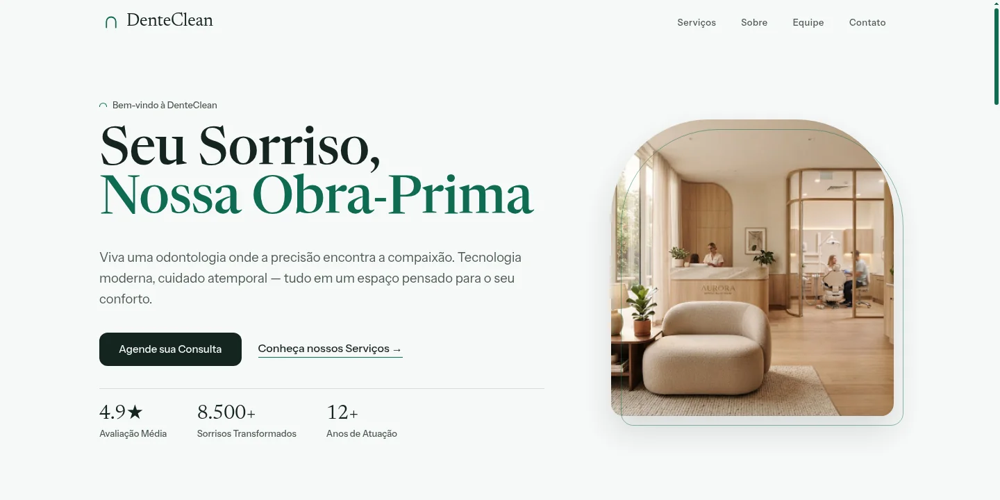

# Template de Site DenteClean

[English](README.md)

Site institucional estático e configurável, feito com HTML, CSS e JavaScript puro. Textos da clínica, contatos, imagens e informações de acessibilidade ficam em `site.config.json`; o HTML e o JavaScript fornecem a estrutura reutilizável e o comportamento.

[](screenshots/desktop-full.webp)

## Pré-visualização

Requer Node.js 18 ou superior. Neste diretório, execute:

```bash
npm run preview
```

Acesse `http://127.0.0.1:4173`. O servidor local serve apenas para pré-visualização; o site é estático. Sirva por HTTP, porque a página carrega `site.config.json` com `fetch` — abrir `index.html` direto do sistema de arquivos não renderiza o conteúdo configurado.

Capturas de página inteira: [desktop (1440 px)](screenshots/desktop-full.webp), [tablet (768 px)](screenshots/tablet-full.webp) e [celular (390 px)](screenshots/mobile-full.webp).

## Personalização

Edite `site.config.json` diretamente ou execute `npm run setup` para responder perguntas sobre nome da clínica, telefone exibido, telefone do link `tel:`, número do WhatsApp, e-mail, endereço e cidade. O assistente mantém o valor atual quando a resposta fica em branco e não altera o restante do config (horários, redes sociais, serviços, equipe, estatísticas, textos da página etc.).

`site.config.json.example` é uma cópia inicial. `clinic.name`, `clinic.phone`, `clinic.phoneLink`, `clinic.whatsapp`, `clinic.email`, `clinic.address` e `clinic.city` são obrigatórios; `clinic.hours`, `clinic.tagline` e `clinic.social` são opcionais.

O config contém apenas conteúdo da clínica:

- `copy` — textos estáticos da página, no formato texto original → substituição. As chaves são comparadas após remover espaços nas pontas e compactar espaços internos, e o literal "DenteClean" no texto renderizado é substituído por `clinic.name`.
- `ui` — títulos e corpos de diálogos, mensagens do formulário e avisos.
- `attributeText` — textos alternativos, placeholders, rótulos acessíveis, títulos e avisos, indexados pelo valor original do atributo. Os valores podem usar `{name}` e `{phone}`.
- `attributes` — substituições por seletor para `alt`, `aria-label`, `placeholder`, `title` e `data-toast`. Os valores podem usar `{name}`, `{phone}`, `{whatsapp}` e `{email}`.
- `images` — seletor → caminho local de imagem ou URL.
- `clinic`, `clinic.social`, `links` — identidade e contato, destinos sociais e demais links. `links` mapeia seletores para URLs, com `links.whatsapp` como chave especial da ação de WhatsApp; `{whatsapp}` pode representar o número configurado.
- `services`, `team` e `stats` — listas que podem ser adicionadas, removidas ou reordenadas. Serviços usam `title`, `description`, `image`, `alt`, `badges` e `dialog`; equipe usa `name`, `role`, `description`, `image` e `badges`; estatísticas usam `value` e `label`.

A estrutura e a aparência da página são definidas no HTML e CSS. Novos componentes estruturais exigem mudanças no código.

O formulário de agendamento é apenas uma demonstração: valida os campos e exibe um retorno simulado, mas não envia dados. Para agendar de verdade, use os links de telefone ou WhatsApp.

Valores inválidos são indicados na página, normalmente com o caminho do campo que precisa de correção. Formatos de e-mail, `phoneLink` e WhatsApp são verificados; imagens devem usar caminho local ou URL que não seja `javascript:` nem `data:`; destinos sociais e externos devem usar HTTP ou HTTPS. Links e diálogos de contato usam os dados configurados.

## Build

```bash
npm run build
```

O site estático completo é gerado em `dist/`. Sirva essa pasta com qualquer servidor estático, por exemplo `npm run preview -- dist`. A porta padrão é 4173; defina `PORT` para alterá-la.

## Estrutura

```text
index.html               Estrutura da página
style.css                Estilos e layout responsivo
app.js                   Interações e renderização do config
site.config.json         Conteúdo da clínica
site.config.json.example Exemplo de configuração
scripts/                 Ferramentas de prévia, build e configuração
assets/images/           Imagens do site
design/design.md         Documentação do design system
screenshots/             Capturas de página inteira e da hero
PRODUCT.md               Contexto do produto
README.pt-BR.md          README em português
LICENSE                  Licença MIT
```

O repositório não possui suíte de testes automatizados. Para conferir o visual, pré-visualize em larguras desktop e mobile e verifique navegação, diálogos, links de contato e retorno do formulário.

## Licença

[MIT](LICENSE) © 2026 DaviMGDev
